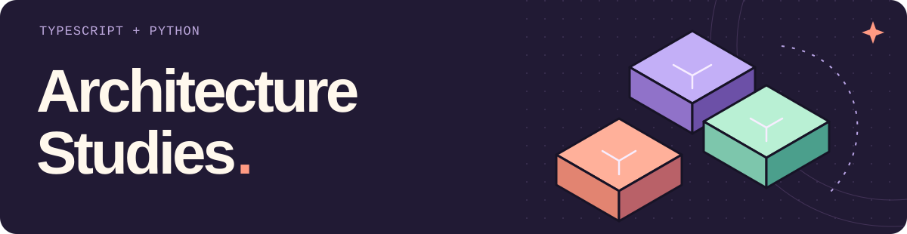
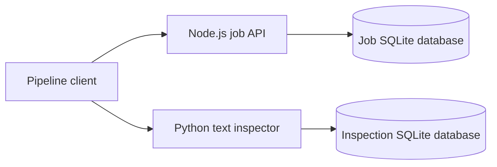

<picture>
  <source media="(max-width: 600px)" srcset="assets/readme-header-mobile.svg">
  
</picture>

A document-inspection service with **three backend designs**: layered, ports and
adapters, and CQRS with an event journal. Node.js owns the job lifecycle; a
Python service computes text statistics and a SHA-256 digest. Both APIs persist
to SQLite.

[Compare the designs](docs/architecture-comparison.md) ·
[Node API](docs/node-api.md) · [Python API](python/README.md) ·
[Verification scope](AI_ASSISTANCE.md)

## Follow one job

Use **Node.js 24 LTS**; CI also exercises Node 22. From the repository root:

```sh
npm ci
npm run demo
```

The in-memory demo runs the same failed attempt and retry through all three
architectures. An excerpt from the actual CLI output:

```text
Layered
submit   queued | attempts=0 | version=1
start    processing | attempts=1 | version=2
fail     failed | attempts=1 | version=3
retry    queued | attempts=1 | version=4
start    processing | attempts=2 | version=5
complete completed | attempts=2 | version=6
resubmit same id=true | completed | attempts=2 | version=6
other tenant sees 0 jobs
```

The ports-and-adapters and CQRS runs produce the same lifecycle. The demo then
makes CQRS projection lag visible:

```text
After start, stale read = queued
After delivery, read = processing
After rebuild, read = processing
```

This first demo exercises domain behavior in memory. The next example uses the
HTTP and persistence implementations.

## Inspect a file through two real APIs

Add **Python 3.11+** and install the worker environment:

```sh
python3 -m venv python/.venv
python/.venv/bin/python -m pip install -r python/requirements-dev.lock
npm run build
```

Start the job API in one terminal:

```sh
ARCHITECTURE=hexagonal DB_PATH=.local/jobs-hexagonal.sqlite npm start
```

Start the inspector in a second terminal:

```sh
cd python
WORKER_DB_PATH=.local/inspections.sqlite WORKER_PORT=8000 .venv/bin/python -m architecture_worker
```

From the repository root in a third terminal:

```sh
python3 scripts/study_pipeline.py --file examples/sample-note.txt
```

Selected fields from a recorded first response against fresh databases; generated
IDs and other fields are omitted here:

```json
{
  "job": {"state": "completed", "attemptCount": 1},
  "inspection": {"utf8Bytes": 156, "codePoints": 156, "words": 24, "lines": 4},
  "reused": false
}
```

Run the same client command again: `reused` becomes `true`, with the same job ID,
inspection receipt and attempt count. The client stores the JSON inspection
receipt in the job's existing `text` result field. Stop and restart both APIs to
inspect the persisted result.

The services bind to `127.0.0.1`, on ports 3000 and 8000. For alternate ports,
set `PORT` / `WORKER_PORT` and pass `--jobs-url` / `--worker-url` to the client.
Switch `ARCHITECTURE` to `layered` or `cqrs`, using a separate `DB_PATH` for each.



## What changes between designs

| Design | Where decisions live | Persistent state | Cost to examine |
| --- | --- | --- | --- |
| Layered | Application service | Concrete SQLite data layer | Short call path, but storage and transaction details stay close to the service. |
| Ports and adapters | Domain aggregate; application coordinates ports | SQLite repository adapter | Infrastructure can change without importing it into the domain; more interfaces and translation to maintain. |
| CQRS with events | Rehydrated write aggregate | Append-only events and submission index; rebuildable read projection | History and replay are explicit; reads, writes, projection recovery and version ordering need separate treatment. |

The Python service uses a pure inspector, an application/repository boundary,
and an HTTP adapter. It complements the three Node variants; it is not a second
copy of all three.

Follow one failure and retry through the actual code in
[the architecture comparison](docs/architecture-comparison.md).
The [Node API contract](docs/node-api.md) and
[Python service guide](python/README.md) cover endpoints, schemas, transactions
and error responses.

## Test the behavior, storage and service boundaries

```sh
npm test
npm run demo
(cd python && .venv/bin/python -m pytest)
python/.venv/bin/python -m unittest discover -s integration -p 'test_*.py' -v
```

- Shared contract tests run the same lifecycle against each architecture.
- Model-based tests generate command sequences and storage reopen operations;
  fast-check shrinks failures and supports seed/path replay.
- Node and Python integration tests use real HTTP and temporary SQLite files,
  including concurrent requests from separate processes and injected write failures.
- Cross-service tests start both services, run the pipeline through all three
  architectures, kill and restart processes after committed responses, and check
  idempotent replay, tenant isolation and failed-worker recovery.
- Client boundary tests exercise redirects, proxy settings and exact CRLF input
  bytes through the real CLI.

A process-kill test after a committed response is evidence of restart behavior;
it does not establish power-loss durability. See
[verification and assistance scope](AI_ASSISTANCE.md) for the tested versions.

## Deliberate limits

This is a local service study. Tenant IDs come from a header supplied by the caller;
an exposed deployment would need an authenticated identity boundary. Text is
supplied as UTF-8, not extracted by OCR. The inspector stores hashes and counts,
not raw text.

The pipeline is a resumable single coordinator. Its two databases do not share
a transaction. If the worker fails after a job starts, the client records a failed
attempt; running it again explicitly retries. There are no automatic retries,
background workers, leases, distributed exactly-once claims or payment actions.
The persisted inspection key prevents duplicate inspection receipts when a
response is lost.

SQLite keeps local setup small and supports the transaction tests. The Node
driver is synchronous, so database work blocks its event loop. There is no
throughput benchmark here. [SQLite serializes writes](https://www.sqlite.org/isolation.html);
using more API processes does not create more simultaneous SQLite writers.

## Earlier pattern exercises

The original [C# examples](DesignPatternStudy) and
[original README](docs/original-pattern-study.md) remain unchanged, along with
their Git history. They target .NET Core 3.1 and sit outside the active build,
CI and language statistics.

The new studies are [MIT licensed](LICENSE). Historical C# material is excluded
from that license scope. [Owner exercises](docs/architecture-comparison.md#owner-exercises)
remain open until their results are recorded.
