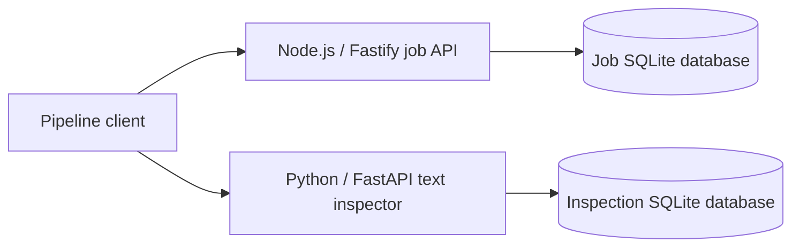

# Architecture Studies

A local document-inspection service, implemented with three backend designs.
Node.js owns the job lifecycle; a Python API computes text statistics and a
SHA-256 digest. Both services use SQLite, and the integration suite talks to real
HTTP servers.

The same API runs as a layered application, ports and adapters, or CQRS with an
event journal. Switching the architecture changes where state and transactions
live, while the observable job behavior stays the same.



## Run it

Use **Node.js 24 LTS** and **Python 3.11+**. CI also exercises Node 22.
Install from the repository root:

```sh
npm ci
npm run build
python3 -m venv python/.venv
python/.venv/bin/python -m pip install -r python/requirements-dev.lock
```

Start the job API in one terminal:

```sh
ARCHITECTURE=hexagonal DB_PATH=.local/jobs-hexagonal.sqlite npm start
```

Start the inspector in a second terminal:

```sh
cd python
WORKER_DB_PATH=.local/inspections.sqlite WORKER_PORT=8000 .venv/bin/python -m architecture_worker
```

Then submit the included sample from the repository root:

```sh
python3 scripts/study_pipeline.py --file examples/sample-note.txt
```

The client creates a job, starts an attempt, calls the inspector, and stores its
JSON receipt in the job's existing `text` result field. Run the command again:
the IDs, result and attempt count stay the same. Stop and restart both services
to check the result is still there.

Set `ARCHITECTURE=layered` or `ARCHITECTURE=cqrs` to compare designs. Use a
different `DB_PATH` for each study. The job API defaults to port 3000; the
inspector defaults to 8000. Both bind to `127.0.0.1`.

## What changes between designs

| Design | Where decisions live | Persistent state | Cost to examine |
| --- | --- | --- | --- |
| Layered | Application service | Concrete SQLite data layer | Short call path, but storage and transaction details stay close to the service. |
| Ports and adapters | Domain aggregate; application coordinates ports | SQLite repository adapter | Infrastructure can change without importing it into the domain; more interfaces and translation to maintain. |
| CQRS with events | Rehydrated write aggregate | Append-only events and submission index; rebuildable read projection | History and replay are explicit; reads, writes, projection recovery and version ordering need separate treatment. |

The Python service uses a pure inspector, an application/repository boundary,
and an HTTP adapter. It complements the three Node variants; it is not a second
copy of all three.

Follow one failure and retry through the actual code in
[the architecture comparison](docs/architecture-comparison.md).
The [Node API contract](docs/node-api.md) and
[Python service guide](python/README.md) cover endpoints, schemas, transactions
and error responses.

## Test the behavior, storage and service boundaries

```sh
npm test
npm run demo
(cd python && .venv/bin/python -m pytest)
python/.venv/bin/python -m unittest discover -s integration -p 'test_*.py' -v
```

- Shared contract tests run the same lifecycle against each architecture.
- Model-based tests generate command sequences and storage reopen operations;
  fast-check shrinks failures and supports seed/path replay.
- Node and Python integration tests use real HTTP and temporary SQLite files,
  including concurrent requests from separate processes and injected write failures.
- Cross-service tests start both services, run the pipeline through all three
  architectures, kill and restart processes after committed responses, and check
  idempotent replay, tenant isolation and failed-worker recovery.
- Client boundary tests exercise redirects, proxy settings and exact CRLF input
  bytes through the real CLI.

A process-kill test after a committed response is evidence of restart behavior;
it does not establish power-loss durability. See
[verification and assistance scope](AI_ASSISTANCE.md) for the tested versions.

## Deliberate limits

This is a local service study. Tenant IDs come from a header supplied by the caller;
an exposed deployment would need an authenticated identity boundary. Text is
supplied as UTF-8, not extracted by OCR. The inspector stores hashes and counts,
not raw text.

The pipeline is a resumable single coordinator. Its two databases do not share
a transaction. If the worker fails after a job starts, the client records a failed
attempt; running it again explicitly retries. There are no automatic retries,
background workers, leases, distributed exactly-once claims or payment actions.
The persisted inspection key prevents duplicate inspection receipts when a
response is lost.

SQLite keeps local setup small and supports the transaction tests. The Node
driver is synchronous, so database work blocks its event loop. There is no
throughput benchmark here. [SQLite serializes writes](https://www.sqlite.org/isolation.html);
using more API processes does not create more simultaneous SQLite writers.

## Earlier pattern exercises

The original [C# examples](DesignPatternStudy) and
[original README](docs/original-pattern-study.md) remain unchanged, along with
their Git history. They target .NET Core 3.1 and sit outside the active build,
CI and language statistics.

The new studies are [MIT licensed](LICENSE). Historical C# material is excluded
from that license scope. [Owner exercises](docs/architecture-comparison.md#owner-exercises)
remain open until their results are recorded.
