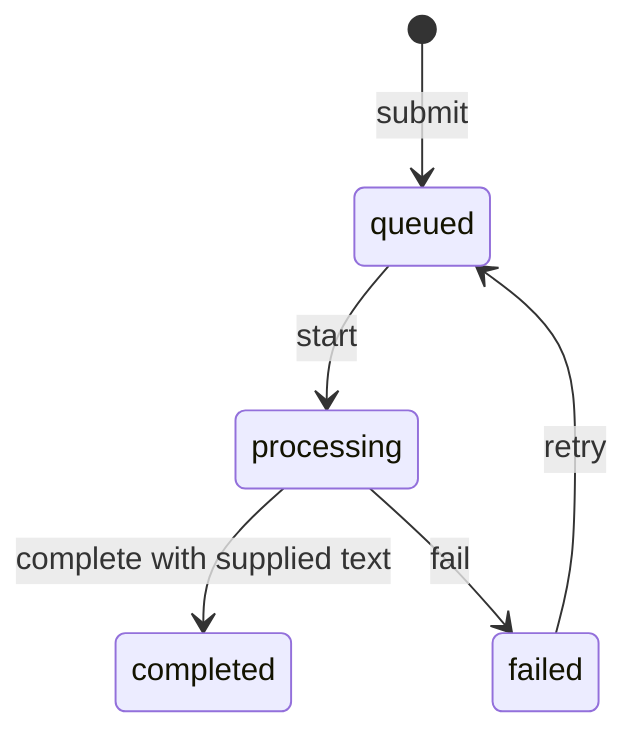

# Architecture Studies

Three TypeScript implementations of one document-job workflow. The comparison follows where rules, dependencies, and failure handling actually live.

A caller submits a document name, starts a processing attempt, and supplies either text or a failure. A failed job can be retried. The demo uses synthetic text; it does not read documents, run OCR, or call an AI model.

## Run it

Use **Node.js 24 LTS** and npm. Node 22 is also included in the CI matrix. No database, API keys, or external services are needed.

```sh
npm ci
npm test
npm run demo
```

`npm test` builds seven workspace packages with strict TypeScript project references, then runs Node's built-in test runner. `npm run demo` runs the same failure/retry/completion sequence through all three implementations, followed by an explicit projection-lag example.

## The three implementations

| Study | Where to start | What changes |
| --- | --- | --- |
| Layered application | [Application service](packages/layered/src/index.ts) | The service owns transitions and depends on a concrete in-memory data layer. |
| Ports and adapters | [Application use cases](packages/hex-application/src/index.ts) → [domain](packages/hex-domain/src/index.ts) | The aggregate owns transitions; the application defines repository and ID-generation ports implemented by adapters. Domain and application compile without Node types or framework imports. |
| CQRS with in-process events | [Commands](packages/event-driven/src/index.ts) → [read projection](packages/event-driven/src/projection.ts) | Commands reconstruct state from events. Queries use a separate projection whose delivery can be paused, caught up, and rebuilt. |

All three implement the same [external contract](packages/contracts/src/index.ts) and pass the same [behavioral tests](tests/workflow-contract.test.mjs). They share API types, not transition implementations.



Tests also cover tenant-scoped idempotency, cross-tenant commands, invalid transitions, mutation-resistant snapshots, save failures, projection gaps/redelivery, and event-store version conflicts. [Dependency checks](tests/boundaries.test.mjs) keep workspace import directions explicit.

## What to study next

Read the [comparison and exercises](docs/architecture-comparison.md). It follows one use case through each implementation and explains the costs that show up when storage fails or reads lag behind writes.

This baseline is synchronous and runs in one process. Every store is in memory. Tenant IDs are supplied by the caller; there is no authentication or authorization layer. Submission identity uses a tenant, key, and document name—not a content hash. Tests establish those local behaviors, not distributed delivery, crash recovery, or production readiness.

## Earlier pattern exercises

Original C# examples remain unchanged in [DesignPatternStudy](DesignPatternStudy), with their [original README](docs/original-pattern-study.md) preserved. They target .NET Core 3.1 and are historical material, outside the TypeScript build, CI, and language statistics. They were not rebuilt or migrated for this update. Existing Git history is retained.

New study code is [MIT licensed](LICENSE); the license scope excludes the historical C# archive. [AI assistance and verification scope](AI_ASSISTANCE.md) are recorded separately. This is a runnable study baseline; owner walkthroughs and exercise results have not yet been recorded.
